# 📦 Inventory Optimization System

Full-stack web application that **forecasts demand and recommends optimal stock levels**
using EOQ, Safety Stock, Reorder Point and ABC/XYZ classification.

> 🎓 Bachelor's thesis project — graded **90/100**.

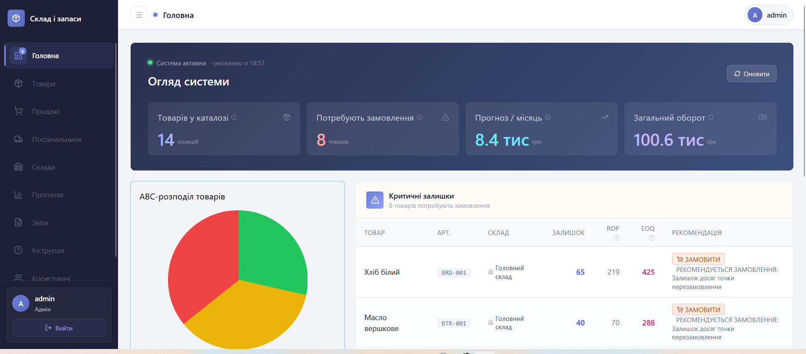

🖥 **Frontend repository:** [inventory-management-frontend](https://github.com/DROSE-25/inventory-management-frontend)

## ✨ Features

- **Demand forecasting:** Simple & Weighted Moving Average, Simple Exponential Smoothing, Holt, Linear Regression (plus a naive baseline) — compared by **MAE, MAPE and RMSE**
- **Inventory optimization:** EOQ (Wilson formula), Safety Stock, Reorder Point
- **ABC/XYZ analysis** of the product range
- **Multi-company isolation**, JWT authentication, roles: ADMIN / MANAGER / ANALYST
- **CRUD** for products, suppliers, warehouses, sales and users, with CSV import of sales
- **Reports** export to CSV, Excel and PDF (Cyrillic supported)
- REST API documented with Swagger / OpenAPI
- Database versioning with Flyway migrations

## 📸 Screenshots

### Dashboard
| | |
|---|---|
|  | 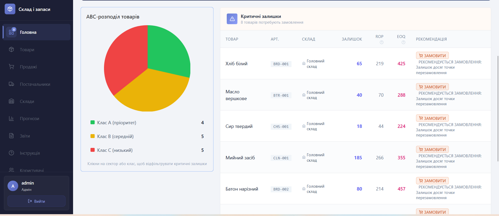 |

### Demand forecasting
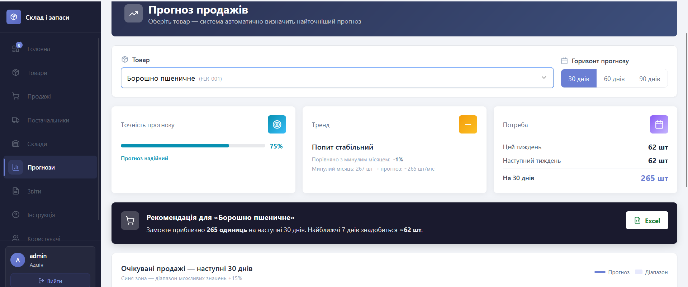

### Reports & analytics
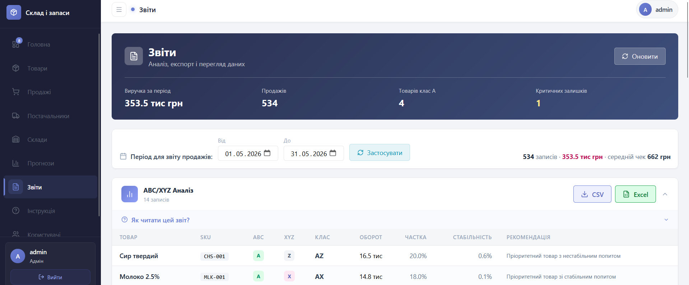

### Products & suppliers
| | |
|---|---|
| 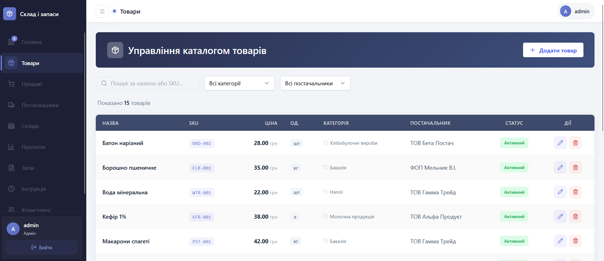 | 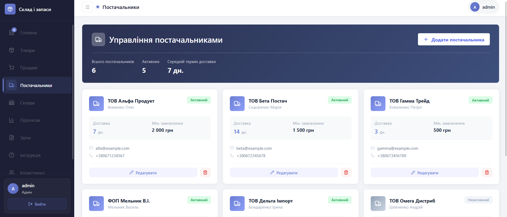 |

### Sales
| | |
|---|---|
| 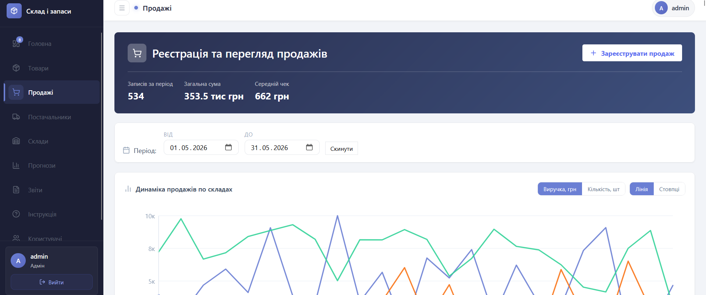 | 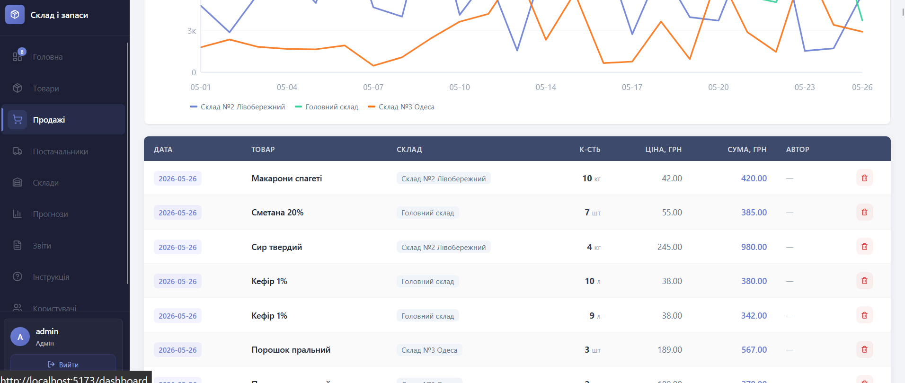 |

### Users & built-in help
| | |
|---|---|
| 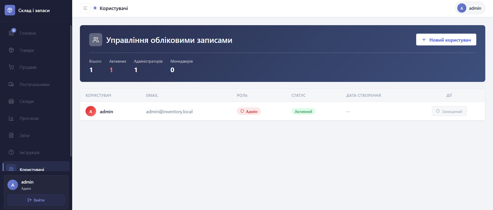 | 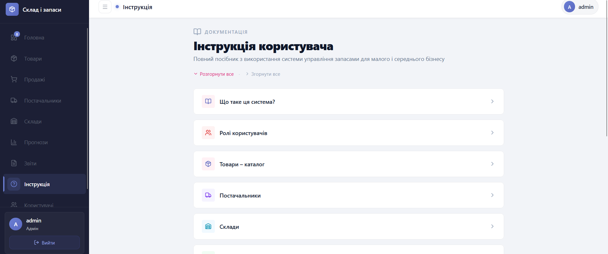 |

## 🏗 Architecture

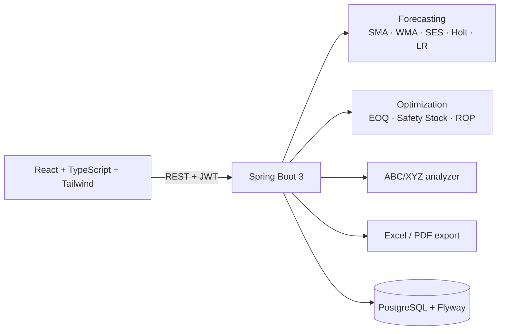

## 🧮 How it works

- **EOQ** = √(2·D·S / H), where D is annual demand, S is the ordering cost and H is the holding cost per unit
- **Safety stock** is calculated from demand variability, supplier lead time and the target service level
- **Reorder point** = average demand during lead time + safety stock
- **ABC/XYZ:** ABC ranks products by their revenue contribution, XYZ by demand stability (variation of sales)
- **Forecast methods** are evaluated on historical sales and ranked by error metrics, so the best method per product can be chosen

## 🛠 Tech stack

| Layer | Technologies |
|---|---|
| Backend | Java 21, Spring Boot 3, Spring Security + JWT, Spring Data JPA / Hibernate, Flyway, MapStruct, Lombok |
| Database | PostgreSQL 15 |
| Frontend | React 19, TypeScript, Vite, Tailwind CSS, shadcn/ui, Chart.js, Zustand |
| Reports | Apache POI (Excel), iText (PDF), OpenCSV |
| DevOps | Docker, Docker Compose |
| Testing | JUnit 5, Mockito, Spring Test, H2 — 116 tests |

## 🚀 Quick start

### 1. Backend + database (Docker)

```bash
git clone https://github.com/DROSE-25/inventory-management.git
cd inventory-management
docker-compose up --build
```

Swagger UI: http://localhost:8080/swagger-ui.html

### 2. Frontend

```bash
git clone https://github.com/DROSE-25/inventory-management-frontend.git
cd inventory-management-frontend
npm install
npm run dev
```

Open http://localhost:5173

### 3. Demo data (optional)

The repository includes `seed_data.sql`: 15 electronics products, 5 categories, 4 suppliers and 180 days of sales history.

```bash
docker cp seed_data.sql inventory-management-postgres-1:/tmp/seed_data.sql
docker exec -it inventory-management-postgres-1 psql -U postgres -d inventory_db -f /tmp/seed_data.sql
```

Then log in and open **Reports → ABC/XYZ → Recalculate**.

### Demo account

| Login | Password |
|---|---|
| `admin` | `Demo12345` |

## ⚙️ Environment variables

| Variable | Description | Default |
|---|---|---|
| `SPRING_DATASOURCE_URL` | Database URL | `jdbc:postgresql://localhost:5432/inventory_db` |
| `SPRING_DATASOURCE_USERNAME` | Database user | `postgres` |
| `SPRING_DATASOURCE_PASSWORD` | Database password | `postgres` |
| `JWT_SECRET` | Secret for signing JWT tokens | development default |

## 👥 Roles

| Role | Access |
|---|---|
| ADMIN | Full access |
| MANAGER | View + register sales |
| ANALYST | View and analytics only |

## 🔌 API overview

| Endpoint | Purpose |
|---|---|
| `/api/auth` | Login, registration |
| `/api/products`, `/api/suppliers`, `/api/warehouses`, `/api/categories` | Reference data |
| `/api/sales`, `/api/stock` | Sales and stock levels |
| `/api/forecast` | Forecasts and method comparison |
| `/api/optimization` | EOQ, safety stock, reorder point |
| `/api/analysis` | ABC/XYZ analysis |
| `/api/reports`, `/api/forecast-export` | CSV / Excel / PDF export |
| `/api/users` | User management |

Full interactive documentation is available in Swagger UI.

## 🧪 Tests

```bash
./mvnw test
```

Unit tests cover the forecasting methods, accuracy evaluator, EOQ / safety stock / reorder point calculators and ABC/XYZ analysis. Controller and repository tests cover the REST layer and data access.

## 📄 License

MIT
